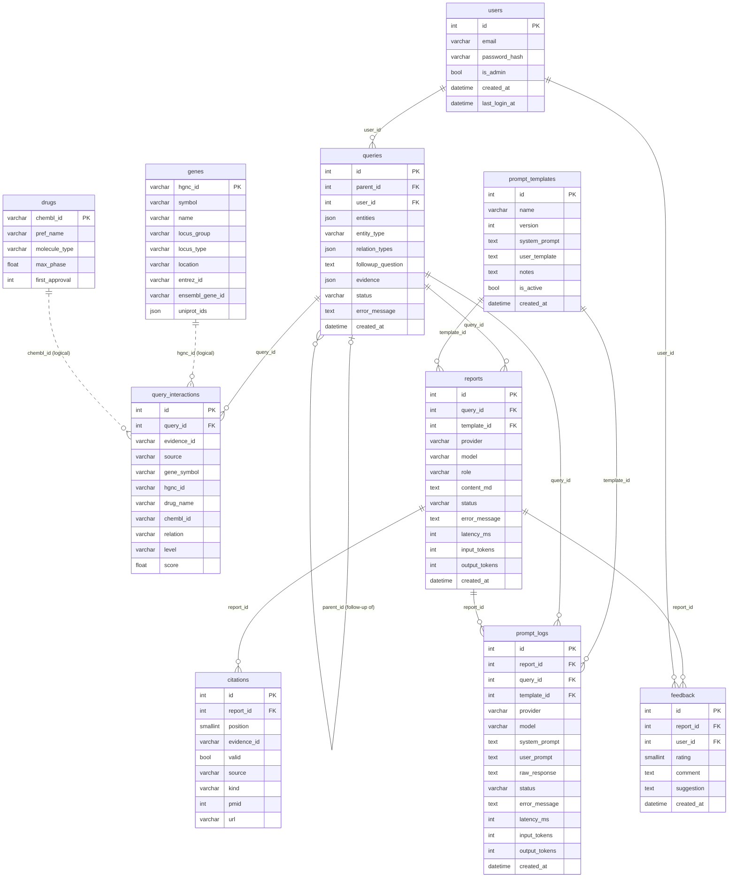

# Database design

Pharmagenix stores two kinds of data in one MySQL 8 database (`dgi_explorer`):

- **Application data**: who searched for what, the evidence each search found, the LLM reports, their citations,
  user feedback and every prompt sent to an LLM.
- **Reference datasets**: local copies of HGNC, ChEMBL, CPIC, ClinPGx, DGIdb, FDA, OncoTree, IntOGen, CIViC,
  cancerhotspots.org, cBioPortal and the PBS Schedule, loaded by `flask --app run import-data`.

The tables are defined as SQLAlchemy models (`backend/app/models.py`, `backend/app/reference/models.py`).
`backend/schema.sql` is the MySQL DDL generated from them (`flask --app run dump-schema`), and the diagrams below are
generated the same way (`flask --app run dump-er`), so neither can drift from the code.

## Application tables



| Table | One row per | Purpose (brief's suggested table) |
| --- | --- | --- |
| `users` | account | Login (email + salted password hash); `is_admin` opens the admin console |
| `queries` | search | What was asked (gene, drug or VCF sample, relation types, follow-up question), by whom (`user_id`), when, and the evidence bundle shown on the results page. A follow-up points to its parent (`parent_id`). *Prompts, Query_History* |
| `query_interactions` | drug–gene evidence item of a search | The drug–gene pairs a search found: gene (HGNC ID), drug (ChEMBL ID), relation, evidence level, score and source. *Interactions* |
| `reports` | LLM answer | The narrative an LLM wrote for a search (primary, comparison model or Workflow 4 agent), its status, model, latency and token use. *LLM_Responses* |
| `citations` | evidence item cited by a report | Which evidence a report cited, in order, with its source and PubMed ID; `valid = 0` marks a citation to evidence that was not in the prompt. *Citations* |
| `prompt_templates` | template version | Editable prompt templates; editing creates a new version so old reports stay reproducible |
| `prompt_logs` | LLM call | The exact prompt sent and raw response received, including failures (admin console) |
| `feedback` | rating | A user's rating (1–5), comment and suggestion for a report. *User_Feedback* |

## Reference datasets

```mermaid
%% Reference datasets
erDiagram
    clinpgx_guidelines ||--o{ clinpgx_guideline_pairs : "guideline_id"
    drugs ||--o{ drug_synonyms : "chembl_id"
    genes ||--o{ gene_aliases : "hgnc_id"
    genes ||..o{ drug_mechanisms : "hgnc_id (logical)"
    genes ||..o{ gene_pathways : "gene_symbol (logical)"
    pbs_restrictions ||..o{ pbs_item_restrictions : "res_code (logical)"
    pbs_items ||..o{ pbs_item_restrictions : "pbs_code (logical)"
    genes ||..o{ civic_evidence : "gene_symbol (logical)"
    drugs ||..o{ cpic_pairs : "chembl_id (logical)"
    cancer_hotspots {
        int id PK
        varchar gene_symbol
        varchar residue
        int start
        int end
        varchar hotspot_type
        int tumor_count
        json variant_amino_acids
    }
    civic_evidence {
        int id PK
        int evidence_id
        varchar gene_symbol
        varchar molecular_profile
        int molecular_profile_id
        json components
        varchar disease
        varchar doid
        json therapies
        varchar therapy_interaction
        varchar direction
        varchar level
        varchar significance
        text statement
        int pmid
        varchar citation
        int rating
        varchar variant_origin
        varchar url
    }
    clinpgx_drug_labels {
        int id PK
        varchar label_id
        varchar name
        varchar source
        varchar gene_symbol
        varchar hgnc_id
        varchar drug_name
        varchar drug_name_norm
        varchar chembl_id
        varchar biomarker_flag
        varchar testing_level
        bool has_prescribing_info
        bool has_dosing_info
        bool has_alternate_drug
        bool has_other_prescribing_guidance
        bool cancer_genome
        text variants
        date latest_history_date
        varchar url
    }
    clinpgx_guidelines {
        varchar guideline_id PK
        varchar name
        varchar source
        bool recommendation
        bool dosing_information
        bool alternate_drug_available
        bool other_prescribing_guidance
        bool has_testing_info
        bool pediatric
        bool cancer_genome
        text summary
        text text
        json pmids
        varchar url
    }
    clinpgx_relationships {
        int id PK
        varchar gene_pa_id
        varchar gene_symbol
        varchar hgnc_id
        varchar chemical_pa_id
        varchar drug_name
        varchar drug_name_norm
        varchar chembl_id
        json evidence
        varchar association
        bool pk
        bool pd
        json pmids
    }
    cpic_allele_frequencies {
        int id PK
        varchar gene_symbol
        varchar allele_name
        varchar population_group
        int subject_count
        float freq_weighted_avg
        float freq_avg
        float freq_min
        float freq_max
    }
    cpic_alleles {
        int id PK
        varchar gene_symbol
        varchar allele_name
        varchar function_status
        varchar clinical_function_status
        varchar clinical_function_substrate
        varchar activity_value
        varchar strength
        json pmids
    }
    cpic_diplotypes {
        int id PK
        varchar gene_symbol
        varchar diplotype
        varchar function1
        varchar function2
        varchar activity_value1
        varchar activity_value2
        varchar total_activity_score
        varchar phenotype
        json lookup_key
    }
    cpic_gene_results {
        int id PK
        varchar gene_symbol
        varchar result
        varchar activity_score
        varchar ehr_priority
        text consultation_text
        json frequency
    }
    cpic_pairs {
        int pair_id PK
        varchar gene_symbol
        varchar hgnc_id
        varchar drug_rxnorm_id
        varchar drug_name
        varchar drug_name_norm
        varchar chembl_id
        int guideline_id
        varchar guideline_name
        varchar guideline_url
        varchar cpic_level
        varchar clinpgx_level
        varchar pgx_testing
        bool used_for_recommendation
        json pmids
    }
    cpic_recommendations {
        int id PK
        int guideline_id
        varchar drug_name
        varchar drug_name_norm
        varchar population
        json lookup
        json implications
        text recommendation
        varchar classification
        text comments
    }
    cpic_test_alerts {
        int id PK
        varchar drug_rxnorm_id
        varchar drug_name
        varchar drug_name_norm
        varchar cds_context
        varchar population
        json genes
        json lookup_key
        json alert_text
    }
    dgidb_gene_categories {
        int id PK
        varchar gene_symbol
        varchar hgnc_id
        varchar gene_claim_name
        varchar category
        varchar source_db
    }
    drug_mechanisms {
        int id PK
        int mec_id
        varchar chembl_id
        varchar drug_name
        varchar target_chembl_id
        varchar target_name
        varchar target_type
        varchar hgnc_id
        varchar gene_symbol
        varchar action_type
        varchar mechanism_of_action
        bool direct_interaction
        bool disease_efficacy
        float max_phase
        json pmids
        json ref_urls
    }
    drugs {
        varchar chembl_id PK
        varchar pref_name
        varchar molecule_type
        float max_phase
        int first_approval
    }
    fda_pgx_biomarkers {
        int id PK
        int row_number
        varchar drug_label
        varchar drug_name
        varchar drug_name_norm
        varchar chembl_id
        varchar therapeutic_area
        varchar biomarker
        varchar gene_symbol
        varchar hgnc_id
        json labeling_sections
    }
    gene_pathways {
        int id PK
        varchar pathway
        varchar gene_symbol
        varchar source
    }
    genes {
        varchar hgnc_id PK
        varchar symbol
        varchar name
        varchar locus_group
        varchar locus_type
        varchar location
        varchar entrez_id
        varchar ensembl_gene_id
        json uniprot_ids
    }
    intogen_drivers {
        int id PK
        varchar gene_symbol
        varchar cancer_type
        varchar cohort
        varchar role
        int samples
        float pct_samples
        float qvalue
    }
    oncotree_types {
        varchar code PK
        varchar name
        varchar main_type
        varchar tissue
        varchar parent
        int level
    }
    pbs_item_restrictions {
        int id PK
        varchar pbs_code
        varchar res_code
        varchar benefit_type_code
    }
    pbs_items {
        int id PK
        varchar pbs_code
        varchar drug_name
        varchar drug_name_norm
        varchar chembl_id
        varchar brand_name
        varchar brand_name_norm
        varchar form
        varchar schedule_form
        varchar program_code
        varchar benefit_type_code
        varchar route
        int schedule_code
        date effective_date
    }
    pbs_restrictions {
        varchar res_code PK
        varchar treatment_phase
        varchar authority_method
        text html_text
        int schedule_code
    }
    source_releases {
        int id PK
        varchar source
        varchar version
        varchar url
        json record_counts
        varchar status
        text notes
        datetime imported_at
    }
    subtype_gene_frequencies {
        int id PK
        varchar oncotree_code
        varchar study_id
        varchar gene_symbol
        int altered
        int profiled
        float frequency
    }
    clinpgx_guideline_pairs {
        int id PK
        varchar guideline_id FK
        varchar gene_symbol
        varchar hgnc_id
        varchar drug_name
        varchar drug_name_norm
        varchar chembl_id
    }
    drug_synonyms {
        int id PK
        varchar chembl_id FK
        varchar synonym
        varchar synonym_norm
        varchar syn_type
    }
    gene_aliases {
        int id PK
        varchar hgnc_id FK
        varchar alias
        varchar alias_norm
        varchar alias_type
    }
```

Genes and drugs are the hubs. `genes` (HGNC, ~45k) holds one row per gene with its Entrez ID, Ensembl ID and UniProt
IDs; every name that should resolve to it (approved symbol, previous symbols, aliases) is a row of `gene_aliases`
(~106k). `drugs` (ChEMBL, ~5.6k) and `drug_synonyms` (~58k, including trade names) work the same way.
`gene_pathways` gives each gene's oncogenic signalling pathways. Each dataset's import is recorded in
`source_releases` with its version, so every piece of local evidence can be traced to a data release.

## Normalisation

The tables are in third normal form:

- **1NF**: repeating groups are split into child tables rather than lists in a column: gene aliases
  (`gene_aliases`), drug synonyms (`drug_synonyms`), report citations (`citations`), a search's drug–gene pairs
  (`query_interactions`), the items a PBS restriction applies to (`pbs_item_restrictions`), CPIC recommendations
  (`cpic_recommendations`) and pathway membership (`gene_pathways`).
- **2NF**: every table has a single-column surrogate or natural key (`id`, `hgnc_id`, `chembl_id`, `res_code`), so
  no attribute depends on part of a key. Composite uniqueness is enforced with unique constraints, e.g.
  (`report_id`, `evidence_id`) in `citations`, (`name`, `version`) in `prompt_templates`.
- **3NF**: facts about an entity live with that entity only. A gene's name and identifiers are stored once in
  `genes`, not repeated in every search; `query_interactions` stores the HGNC and ChEMBL IDs and joins to `genes` /
  `drugs` for the rest. A user's email lives only in `users`; queries and feedback point to it by `user_id`.

Foreign keys enforce the application relationships (`ON DELETE CASCADE` from a search to its reports, citations and
interactions; `ON DELETE SET NULL` from a deleted user, so their searches stay for the audit trail).

### Deliberate exceptions

- **`queries.evidence` (JSON)** keeps the complete evidence bundle as shown on the results page. The sources return
  very different structures (a DGIdb interaction, a CIViC evidence item, a CPIC guideline with nested
  recommendations, a variant with its QC trail), and the page must show exactly what the LLM saw at the time, even
  after the reference data is re-imported. The bundle is therefore stored as a snapshot; the parts that are queried
  relationally (drug–gene pairs, citations) are also stored as rows in `query_interactions` and `citations`.
- **`query_interactions.hgnc_id` / `chembl_id`** are indexed but not declared as foreign keys, because
  `import-data` replaces the reference tables wholesale; the IDs themselves are stable across releases. The ER
  diagram draws these as dotted "logical" links.
- **`queries.entities` / `relation_types` (JSON)** are short lists (one gene, a few relation types) that are always
  read and written together with their query.

## Example queries

Which searches found osimertinib for EGFR, from which source and at what evidence level?

```sql
SELECT qi.query_id, q.created_at, qi.source, qi.relation, qi.level, g.name AS gene_name
FROM query_interactions qi
JOIN queries q ON q.id = qi.query_id
LEFT JOIN genes g ON g.hgnc_id = qi.hgnc_id
WHERE qi.gene_symbol = 'EGFR' AND qi.drug_name = 'OSIMERTINIB';
```

How often does each model cite evidence that was not in its prompt?

```sql
SELECT r.model, COUNT(*) AS citations, SUM(NOT c.valid) AS invalid
FROM citations c JOIN reports r ON r.id = c.report_id
GROUP BY r.model;
```

Average rating per prompt template version:

```sql
SELECT t.name, t.version, AVG(f.rating) AS avg_rating, COUNT(f.id) AS ratings
FROM feedback f
JOIN reports r ON r.id = f.report_id
JOIN prompt_templates t ON t.id = r.template_id
GROUP BY t.id;
```

A user's search history:

```sql
SELECT q.id, q.entity_type, q.entities, q.created_at
FROM queries q JOIN users u ON u.id = q.user_id
WHERE u.email = 'demo@pharmagenix.test'
ORDER BY q.created_at DESC;
```

## Creating and upgrading

```bash
flask --app run init-db      # a new database: create every table, seed pathways and the prompt template
flask --app run upgrade-db   # an existing database: add new columns / tables and move old data; safe to re-run
```
